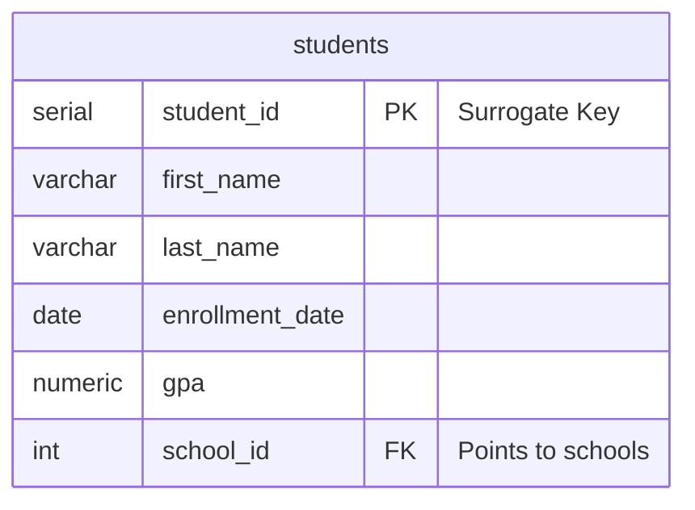
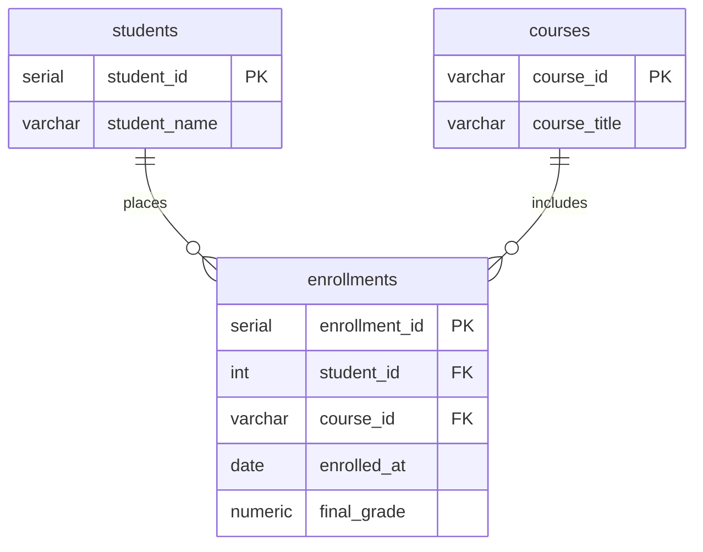

# COS313: Mermaid.js ERD Cheat Sheet

In this course, we use **Mermaid.js** to generate Entity-Relationship Diagrams (ERDs) directly from text. GitHub natively supports Mermaid, which means your diagrams render automatically in markdown previews and pull requests!

---

## 1. How to View and Debug Your Diagrams

### A. Live Side-by-Side Preview in VS Code / Codespaces (Recommended)
GitHub Codespaces includes native Markdown and Mermaid rendering built-in:
* **The Best View:** Press **`Ctrl + K` then `V`** (or `Cmd + K` then `V` on Mac) to open the Markdown Preview side-by-side with your code. The diagram will redraw live as you type!
* **Full Tab View:** Press **`Ctrl + Shift + V`** to open the preview in a full editor tab.
* **The Icon:** Alternatively, click the **"Open Preview to the Side"** icon (split window with magnifying glass) in the upper-right corner of your editor tab.

### B. Interactive Sandbox: Mermaid Live Editor
If you encounter tricky syntax errors or want an interactive visual scratchpad to test your diagram:
1. Open **[mermaid.live](https://mermaid.live)** in your browser.
2. Paste your `erDiagram` code into the left editor pane.
3. The right pane will render the diagram instantly, highlighting specific syntax errors by line number.
4. Once verified, copy your completed block back into `lab_solutions.md`.

### C. Final Submission Verification on GitHub
Once you commit and push your work (`git push`):
1. Navigate to your assignment repository on **GitHub.com** in your browser.
2. Open `lab_solutions.md`.
3. GitHub automatically renders the Mermaid diagram natively in the file view. Use this as your final sanity check before submission!

---

## 2. The Core Structure
Every ERD must start with the keyword `erDiagram` inside a ` ```mermaid ` code block:

````markdown
```mermaid
erDiagram
    %% Comments start with double percent signs.
```
````

---

## 3. Defining Tables (Entities) and Columns
To define a table, write the table name followed by curly braces `{}`. Inside the braces, list columns using the format: `datatype column_name KEY "optional description"`.

* Use **`PK`** to denote a Primary Key (for composite primary keys, tag each key column with `PK`).
* Use **`FK`** to denote a Foreign Key.
* **Naming Rule:** Column and table names must use alphanumeric characters and underscores (`snake_case`). **Do not use spaces or hyphens**, as they cause Mermaid parser errors!



---

## 4. Defining Relationships (Cardinality & Crow's Foot)
To draw lines between tables, place a relationship symbol between the two table names, followed by a `:` and a label in quotes.

**Syntax:** `TableA [Relationship] TableB : "description"`

### The Crow's Foot Connectors
* `||` = Exactly One (The straight double bars)
* `o{` or `}|` = Many (The branched fork / Crow's foot)

| Symbol | Meaning | Example |
| :--- | :--- | :--- |
| **`\|\|--o{`** | **One to Zero-or-Many** *(Most Common!)* | One School has zero or many Students. |
| **`\|\|--\|{`** | **One to One-or-Many** | One Order must have at least one Item. |
| **`\|\|--\|\|`** | **Exactly One to Exactly One** | One User has exactly one Profile. |

> **💡 Directionality Rule:** The straight bar (`||`) touches the **Parent Table** (the "One" side). The fork (`o{`) touches the **Child Table** (the "Many" side)!

---

## 5. The Junction Table Pattern (Many-to-Many Architecture)
In relational database design and on **Exam 2**, Many-to-Many relationships must always be shattered into two One-to-Many relationships using a **Junction Table**:



---

## 6. Exam & Lab Submission Checklist
When submitting a Mermaid diagram on a lab or exam, verify the following:
1. [ ] **Keyword Present:** Does the block begin with `erDiagram`?
2. [ ] **Keys Annotated:** Did you explicitly mark `PK` on primary keys and `FK` on foreign keys?
3. [ ] **Correct Fork Direction:** Are the three prongs (`o{`) pointing at the child/junction table holding the foreign keys?
4. [ ] **Valid Data Types:** Did you use standard types (`varchar`, `int`, `serial`, `numeric`, `date`)?
5. [ ] **Preview Verification:** Did you press `Ctrl + Shift + V` to verify the diagram renders without syntax errors?

---
*For advanced styling and attributes, reference the [Official Mermaid.js ERD Documentation](https://mermaid.js.org/syntax/entityRelationshipDiagram.html).*
