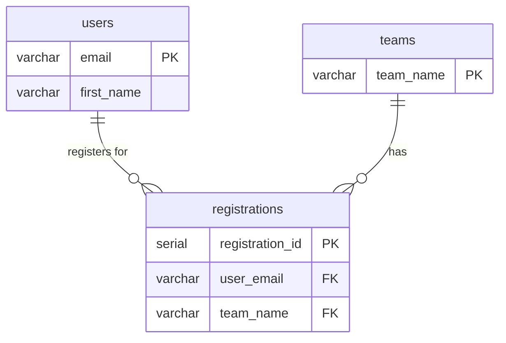

# Lab 7 Solutions

**Student Name:** [Your Name]  
**Student ID:** [Your ID]  
**Date:** [Date]  

---

## Ticket 1: The Visual Audit (Physical ERD)
*Complete the physical architecture diagram below. Refer to `MERMAID_CHEAT_SHEET.md` and Ticket 1 in `IN_CLASS_LAB.md` for attribute details.*

